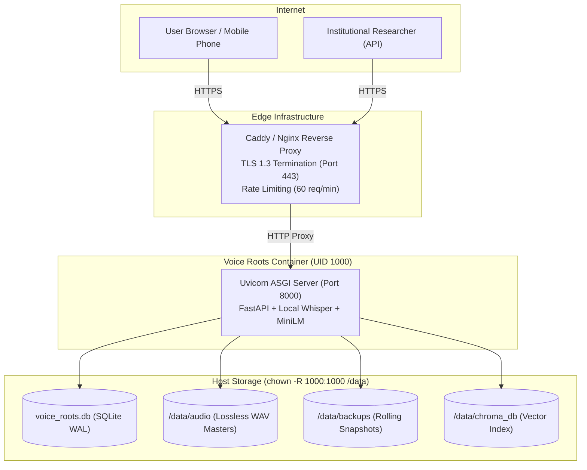

# Voice Roots — Production Deployment & Infrastructure Guide
## Containerized Non-Root Runtime, Turnkey Edge TLS Proxy, Persistent Volumes, and Disaster Rollback

> **Deployment Version**: `1.0.0-production`  
> **Container Security**: Non-Root System User (`appuser:appgroup`, UID 1000)  
> **Persistent Storage Vault**: `/data` (Host Volume Mount)  
> **Edge Reverse Proxy**: Caddy (Automated Let's Encrypt TLS) or Nginx (TLS 1.3)

---

## 1. Deployment Architecture Overview



---

## 2. Host Storage Preparation & Non-Root Permissions

To ensure the non-root container (`appuser`, UID 1000) can read and write persistently without root escalation:

```bash
# 1. Create dedicated host storage directories
sudo mkdir -p /data/audio /data/backups /data/chroma_db

# 2. Grant ownership to UID 1000 (appuser)
sudo chown -R 1000:1000 /data

# 3. Set secure permissions (read/write by appuser only)
sudo chmod -R 750 /data
```

---

## 3. Option A: Turnkey Deployment with Docker Compose (Recommended)

The repository provides a complete turnkey deployment composition in [`deployment/docker-compose.pilot.yml`](file:///Users/harsha/.gemini/antigravity/scratch/voice-roots/deployment/docker-compose.pilot.yml).

### Step 1: Configure Production Environment
Create `/opt/voice-roots/.env`:
```ini
VOICE_ROOTS_ENV=production
VOICE_ROOTS_ADMIN_KEY=YourStrongProductionSecretKey2026!
VOICE_ROOTS_JWT_SECRET=Your64CharacterRandomProductionJwtSigningSecretKeyHere!
VOICE_ROOTS_STORAGE_PATH=/data
AI_PROVIDER=whisper-local
WHISPER_MODEL_SIZE=base
```

### Step 2: Launch Containers
```bash
docker compose -f deployment/docker-compose.pilot.yml up -d --build
```
This launches:
1. `voiceroots-app`: FastAPI application running as `appuser:1000` with volume `/data` mounted.
2. `voiceroots-caddy`: Caddy edge proxy automatically provisioning Let's Encrypt TLS certificates and proxying to port 8000.

### Step 3: Verify Container Health
```bash
# Check container status
docker ps

# Query live storage health probe
curl https://pilot.voiceroots.ai/api/v1/system/storage-probe
```

---

## 4. Option B: Standalone Nginx Reverse Proxy Configuration

If using standard Nginx on Ubuntu/Debian instead of Caddy:

```bash
# Copy provided production Nginx template
sudo cp deployment/nginx.conf /etc/nginx/sites-available/voiceroots.conf
sudo ln -s /etc/nginx/sites-available/voiceroots.conf /etc/nginx/sites-enabled/

# Test syntax and reload
sudo nginx -t
sudo systemctl reload nginx

# Issue Let's Encrypt certificate
sudo certbot --nginx -d pilot.voiceroots.ai
```

Key features configured in `deployment/nginx.conf`:
- **TLS 1.3 & HSTS**: Strict transport security enabled.
- **Audio Range Buffering**: `proxy_cache_bypass $http_range;` ensures smooth audio scrubbing.
- **Rate Limiting Zones**: 60 requests/minute per IP zone to prevent corpus scraping abuse.
- **Payload Bound**: 500 MB max upload for multi-minute high-definition audio recordings.

---

## 5. Zero-Downtime Deployment & Rollback Procedure

### Zero-Downtime Update
```bash
# 1. Pull latest verified integration branch
git pull origin integration/milestones-16-23

# 2. Build updated frontend assets
npm run build --prefix frontend

# 3. Execute database migration upgrade (if any pending)
cd backend && alembic upgrade head && cd ..

# 4. Gracefully reload application server
docker compose -f deployment/docker-compose.pilot.yml restart app
```

### Immediate Rollback Procedure
If an unexpected regression occurs in production:

```bash
# 1. Restore previous application container image
docker compose -f deployment/docker-compose.pilot.yml down
git checkout <previous_commit_sha>

# 2. Restore database from pre-deployment snapshot
cp /data/backups/voice_roots_backup_<PRE_DEPLOYMENT>.db /data/voice_roots.db

# 3. Rerun migrations down if needed
cd backend && alembic downgrade <previous_revision> && cd ..

# 4. Restart container
docker compose -f deployment/docker-compose.pilot.yml up -d
```
All audio masters in `/data/audio` remain completely untouched and preserved during rollback.
