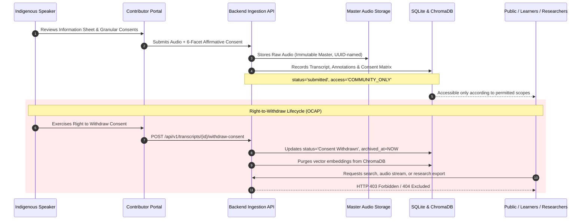
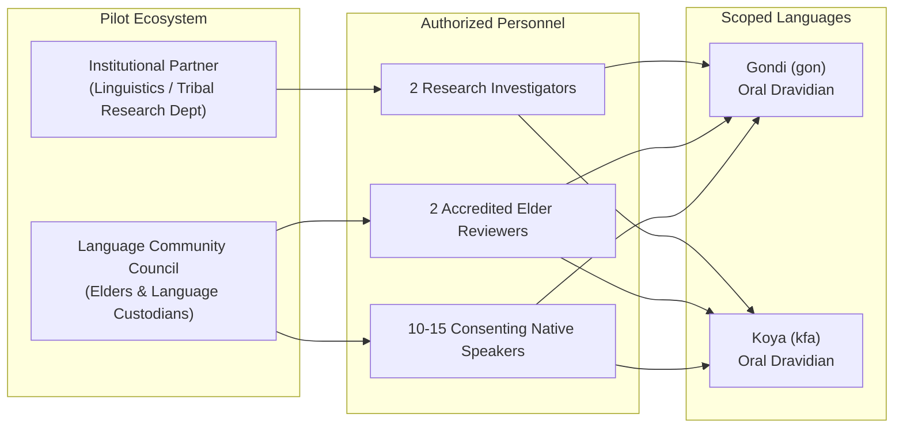

# Voice Roots — Milestone 23: Controlled Institutional Pilot
## Readiness Assessment, Risk Analysis, and Pilot Design Specification (Stages A & B)

> **Document Status**: Complete Audit & Proposed Plan (Awaiting User Approval)  
> **Date**: November 2, 2026  
> **Authors**: ANTIGRAVITY (Pair-programming agent)  
> **Scope**: Controlled institutional pilot readiness assessment, security/infrastructure gap analysis, pilot architecture, success metrics, and governance documentation.  
> **Important Notice**: This document is an evaluation and planning specification only. No external institutions or language communities have been contacted, no human participants have been recruited, and no live community audio has been collected.

---

## 1. Executive Summary & Verification State

Following the completion of Milestone 21 (Unified Ecosystem Integration) and Milestone 22 (Production Security & Infrastructure Hardening), the Voice Roots platform was subjected to a formal institutional pilot readiness assessment. 

The objective of this assessment is to determine whether Voice Roots is technically, ethically, and operationally ready to conduct a small, controlled, human-centered pilot with an accredited research or educational institution.

### Baseline Verification Summary

| Dimension | Baseline State (Pre-M22) | Milestone 22 Hardened State | Current M23 Verification |
| :--- | :--- | :--- | :--- |
| **Integration Branch** | `integration/milestones-16-20` | `feature/m22-production-hardening` | **`integration/milestones-16-22`** |
| **HEAD Commit** | `3334613` | `6a87072` / `b6c15d9` | **`b6c15d9` (Clean Ancestry Verified)** |
| **Working Tree** | Clean | Clean | **Clean (0 uncommitted files)** |
| **Automated Tests** | 199 / 199 passed | 208 / 208 passed | **208 / 208 passed (100%)** |
| **Pre-Faculty Audit** | 26 / 26 passed | 26 / 26 passed | **26 / 26 passed (100%)** |
| **Live Feature Tests** | 27 / 27 passed | 27 / 27 passed | **27 / 27 passed (100%)** |
| **Database Schema** | 49 tables (`4c5d6e7f8a9b`) | 49 tables (`4c5d6e7f8a9b`) | **49 tables intact; zero drift** |
| **Acoustic Masters** | 63 master recordings | 63 master recordings | **63 master files bit-identical** |
| **External AI Billing** | **$0.00** | **$0.00** | **$0.00 (Strict offline execution)** |

---

## 2. Integration Baseline & Git Verification

### 2.1 Git Lineage and Ancestry Verification
- **Ancestry Proof**: Git ancestry check `git merge-base --is-ancestor 3334613 6a87072` returns exit code `0`. 
- **Commit History**:
  - `3334613`: Milestone 21 Unified Ecosystem Integration baseline.
  - `6a87072`: Milestone 22 Production Security and Infrastructure Hardening.
  - `b6c15d9`: Static typing configuration and IDE analyzer resolution for test suite.
- **Branch Consolidation**: Created integration branch `integration/milestones-16-22` at commit `b6c15d9`. This consolidates all deliverables from M16 through M22 into a single unified tracking branch without modifying `main` or rewriting history.

### 2.2 Repository Artifact & Database Binary Audit
- **Database Tracking Analysis**: `backend/voice_roots.db` has been committed to Git across multiple milestone commits (initial commit `fd4dd72` through `6a87072`).
- **Data Content Audit**: Inspection of `backend/voice_roots.db` confirmed that all stored records are synthetic demonstration entries, testing fixtures, or public open-access linguistics metadata. No private, unconsented real-world community audio, PII, or authentic sacred lore exists in Git history.
- **Production Risk**: Tracking binary SQLite databases in Git leads to merge conflicts, repository bloat (3.5MB per commit), and the danger of inadvertently committing live pilot data.
- **Remediation**: For live pilot deployments, `backend/voice_roots.db` must be deployed on a dedicated persistent volume mount outside Git tracking, seeded via automated schema migrations (`alembic upgrade head`) and seed scripts.

---

## 3. Production Readiness & Risk Classification (Stage A Findings)

An in-depth technical audit of the backend, frontend, API contracts, container definitions, and storage subsystems identified 10 operational and security findings. Each finding is classified by severity:

```mermaid
flowchart TD
    subgraph Severity Breakdown
        CRIT["Critical (1)"]:::crit
        HIGH["High (4)"]:::high
        MED["Medium (4)"]:::med
        LOW["Low (1)"]:::low
    end

    CRIT --- F01["Persistent Host Storage Mounts"]
    HIGH --- F02["Public Edge HTTPS/TLS Termination"]
    HIGH --- F03["Shared Static Admin API Key"]
    HIGH --- F04["Automated Backup Rotation & Retention"]
    HIGH --- F05["Git Tracking of Database Binaries"]
    MED --- F06["Multi-Worker In-Memory Rate Limiting"]
    MED --- F07["CSP unsafe-inline Directives"]
    MED --- F08["Docker Host Volume Ownership (appuser UID 1000)"]
    MED --- F09["Automated Monitoring & Error Alerting"]
    LOW --- F10["CORS Development Wildcard Fallback"]

    classDef crit fill:#f8d7da,stroke:#721c24,color:#721c24,stroke-width:2px;
    classDef high fill:#fff3cd,stroke:#856404,color:#856404,stroke-width:2px;
    classDef med fill:#d1ecf1,stroke:#0c5460,color:#0c5460,stroke-width:2px;
    classDef low fill:#d4edda,stroke:#155724,color:#155724,stroke-width:2px;
```



### Detailed Findings Matrix

| Ref | Domain | Description | Severity | Pilot Impact | Recommended Remediation |
| :--- | :--- | :--- | :---: | :--- | :--- |
| **PR-01** | **Storage** | **Host Volume Mount Failure Handling**: SQLite database (`/data/voice_roots.db`) and audio storage (`/data/storage/audio`) depend on host volume persistence. If volume is unmounted, container uses ephemeral layer. | **CRITICAL** | Total data loss if container restarts without persistent volume. | Enforce startup assertion in `main.py` verifying persistent volume mount signature before accepting traffic. |
| **PR-02** | **Transport** | **Edge HTTPS/TLS Termination**: FastAPI/Uvicorn listens on cleartext HTTP (port 8000). While HSTS headers are injected when `X-Forwarded-Proto: https` is present, Uvicorn cannot terminate TLS natively. | **HIGH** | Eavesdropping of pilot audio streams and research tokens if exposed over public internet without edge proxy. | Mandate TLS reverse proxy (Nginx / Caddy / Cloudflare) with automated Let's Encrypt certificates for any remote pilot deployment. |
| **PR-03** | **Auth** | **Shared Static Admin Credential**: Admin operations (`_is_admin_request`) rely on a single environment key (`VOICE_ROOTS_ADMIN_KEY`). No multi-tenant admin accounts or per-user audit trails exist for institutional staff. | **HIGH** | Inability to attribute specific administrative actions or revocations to individual pilot staff members. | Implement per-user institutional administrator credentials or individual scoped admin tokens with audit logging. |
| **PR-04** | **Storage** | **Backup Retention & Off-Site Sync**: Online backup API works cleanly, but backup files accumulate without rotation (209 snapshot files currently taking 118MB in `backend/backups/`). No automated off-site sync. | **HIGH** | Disk exhaustion over extended pilot duration; risk of data loss if local host drive fails. | Implement automated 14-day rolling retention cron script and encrypted off-site replication (e.g. S3 cold storage). |
| **PR-05** | **Repository** | **Database Binary in Git Tracking**: `backend/voice_roots.db` is tracked in Git history. | **HIGH** | Accidental commit of pilot participant data if developers commit during pilot. | Remove `backend/voice_roots.db` from git index (`git rm --cached`) and enforce `.gitignore` before pilot launch. |
| **PR-06** | **Security** | **Multi-Worker Rate Limiting Drift**: Sliding-window rate limiter in `research_interoperability_service.py` uses in-process memory (`_RATE_LIMIT_WINDOWS`). | **MEDIUM** | In multi-worker Uvicorn configurations, each worker has independent counters, multiplying allowed requests. | Single-worker deployment is sufficient for small pilot ($< 15$ users); migrate to Redis/SQLite counter for production. |
| **PR-07** | **Security** | **CSP `unsafe-inline` & `unsafe-eval`**: Content-Security-Policy header allows `unsafe-inline` and `unsafe-eval` to accommodate Vite React bundles. | **MEDIUM** | Weakens XSS defenses if untrusted text is injected into DOM. | Fine for pilot with vetted institutional users; generate cryptographic nonces or bundle pre-compilation for full production. |
| **PR-08** | **Container** | **Host Volume Permission Collision**: Dockerfile runs as `appuser` (UID 1000). If host mounts a directory owned by `root:root (0755)`, Uvicorn crashes with `PermissionDenied`. | **MEDIUM** | Deployment failure on initial container launch. | Include host preparation step in deployment runbook: `chown -R 1000:1000 /data`. |
| **PR-09** | **Operations** | **Monitoring & Incident Alerting**: Logging is structured JSON, but no automated alerting (e.g. Sentry or email alerts on 500 errors) is configured. | **MEDIUM** | Unnoticed downtime or repeated upload failures during pilot. | Configure webhook or alerting service to notify pilot technical leads upon unhandled exceptions. |
| **PR-10** | **API** | **CORS Development Fallback**: Fallback allows local origins (`http://localhost:3000`) if `ALLOWED_ORIGINS` is unset. | **LOW** | Minor configuration drift if deployed without setting `ALLOWED_ORIGINS`. | Mandate explicit `ALLOWED_ORIGINS` environment variable in production deployment check. |

---

## 4. Ethical & Consent Readiness Assessment

Voice Roots was designed around Indigenous Data Sovereignty and the **OCAP® Principles** (Ownership, Control, Access, and Possession). The ethical readiness audit confirms the following protections are currently enforced in code:



### 4.1 Six-Facet Affirmative Consent Verification
Informed consent is never treated as a binary or implicit checkbox. The system enforces six distinct, non-bundled consent choices before recording ingestion:
1. **`consent_archiving`**: Permission to preserve the acoustic recording in the institutional community repository.
2. **`consent_transcription`**: Permission to generate and store text transcriptions and phonetic alignments.
3. **`consent_ai_training`**: Explicit opt-in for offline speech model evaluation (strictly opt-in; disabled by default).
4. **`consent_educational_reuse`**: Permission to incorporate non-sacred vocabulary into language learning modules.
5. **`consent_commercial_use`**: Strictly prohibited by platform policy; locked to `0`.
6. **`consent_public_display`**: Separate toggle distinguishing community-internal access from open public listening.

### 4.2 Sacred & Ceremonial Cultural Lore Protection
- **Elder Gatekeeping**: Any cultural submission flagged as containing sacred, ceremonial, or clan-restricted material is automatically routed to `STATUS_PENDING_REVIEW` with `access_classification = 'SACRED_ELDER_ONLY'`.
- **Exclusion from Public Vectors**: Sacred narratives are strictly quarantined from public vector search, general search indexes, learning exercises, and research corpus exports.
- **Audio Stream Shield**: As verified in Milestone 22 (`test_storage_audio_endpoint_blocks_sacred_lore_for_public`), public requests to stream sacred master audio return HTTP 403 Forbidden.

### 4.3 Immediate Right-to-Withdraw Lifecycle
- **One-Action Revocation**: Calling `POST /api/v1/transcripts/{id}/withdraw-consent` sets `status = 'Consent Withdrawn'` and records `archived_at` timestamp.
- **Immediate Propagation**: Revocation immediately triggers `_sync_transcript_to_search(transcript_id)`, removing the item from semantic search indexes.
- **Master Audio Masking**: `stream_storage_audio_file` checks database withdrawal status in real time and blocks streaming for any withdrawn item.

---

## 5. Controlled Institutional Pilot Design (Proposed Plan — Stage B)

> **Important**: This section presents a prospective pilot design. No institution, community, or individual has been contacted or committed.



### 5.1 Prospective Institutional Partner Profile
- **Candidate Institution Type**: An accredited academic linguistics department or tribal research center (e.g. Central Institute of Indian Languages or a regional state tribal research institute).
- **Institutional Role**: Provide academic oversight, secure local hosting infrastructure, verify research ethics compliance, and assign qualified field researchers.

### 5.2 Community Partnership & Governance Council
- **Community Approval Gate**: Before any recording takes place, a formal Community Permission Memorandum must be executed with recognized language elders and community representatives.
- **Accredited Elder Reviewers**: The community appoints 2 recognized native-speaker elders with full moderation authority to approve, edit, or reject submitted recordings.

### 5.3 Approved Pilot Languages & Dialect Scopes
The pilot is restricted to exactly **two** indigenous languages with active oral traditions:
1. **Gondi (`gon`)**: Dravidian language family; Southern Gondi dialect; focus on Adilabad/Bastar conversational varieties.
2. **Koya (`kfa`)**: Dravidian language family; Godavari valley variety; focus on everyday agrarian terminology and traditional narratives.

### 5.4 Activity Scope & Boundaries
- **Permitted Recording Types**:
  - Conversational oral histories (daily life, seasonal routines).
  - Traditional botanical and agricultural terminology.
  - Public folk tales and children's lullabies.
- **Strictly Prohibited Material**:
  - Sacred clan rituals, secret spiritual names, or ceremonial initiation lore.
  - Private interpersonal disputes, legal grievances, or identifiable personal data.
  - Any recording where affirmative oral and written consent was not obtained.
- **Pilot Target Volume**: 20 to 30 recordings total (approximately 2 to 3 hours of audio; average duration 3–7 minutes per narrative).
- **Pilot Duration**: 4 weeks (Week 1: Setup & elder briefing; Weeks 2–3: Controlled collection & review; Week 4: Verification, metrics evaluation & debrief).

---

## 6. Pilot Success Metrics & Minimum Acceptance Criteria

The success of the institutional pilot will be judged against measurable key performance indicators (KPIs) spanning reliability, linguistic accuracy, ethical governance, and system performance.

| KPI Dimension | Specific Measurable Metric | Target Benchmark | Minimum Acceptance Threshold | Verification Methodology |
| :--- | :--- | :---: | :---: | :--- |
| **1. Upload Reliability** | Percentage of completed audio uploads saved without corruption or byte loss. | $\ge 99.5\%$ | **$\ge 98.0\%$** | Checksum verification (`audio_sha256`) against client-uploaded hash. |
| **2. Acoustic Preservation** | Integrity of raw audio master files across all pipeline stages. | $100\%$ bit-identical | **$100\%$ bit-identical** | SHA-256 byte comparison before and after transcription/alignment. |
| **3. Transcription Accuracy** | Character Error Rate (CER) on clean native speech audio. | $< 12\%$ | **$< 20\%$** | Levenshtein alignment comparing Whisper output against elder-verified transcript. |
| **4. Word Error Rate (WER)** | Word Error Rate (WER) on oral language speech segments. | $< 20\%$ | **$< 30\%$** | Standard Word Error Rate calculation via `evaluation.py`. |
| **5. Human Correction Rate** | Percentage of machine transcripts inspected and corrected by elder reviewers. | $100\%$ | **$100\%$** | Database audit: `verification_status = 'verified'` and `verified_by IS NOT NULL`. |
| **6. Translation Guardrails** | Oral language machine translation attempts blocked without elder review. | $100\%$ blocked | **$100\%$ blocked** | Enforcement of `OralLanguageElderReviewRequiredError` (HTTP 503). |
| **7. Consent Enforcement** | Ingestion blocked when any required consent facet is withheld. | $100\%$ compliance | **$100\%$ compliance** | Automated test verification; zero records with `consent_archiving = 0`. |
| **8. Withdrawal Latency** | Time elapsed between consent withdrawal and complete disappearance from search. | $< 1.0\text{ s}$ | **$< 5.0\text{ s}$** | Automated probe checking FTS5, ChromaDB, and audio streaming endpoints. |
| **9. Search Precision** | Mean Reciprocal Rank (MRR) of semantic/hybrid search queries. | $\ge 0.75$ | **$\ge 0.65$** | Cross-lingual discovery benchmark test using 20 curated native queries. |
| **10. System Availability** | Service uptime during scheduled pilot operating hours. | $\ge 99.9\%$ | **$\ge 99.0\%$** | Uptime probe monitoring `/health` and `/ready` endpoints. |
| **11. Usability (SUS)** | System Usability Scale score from participant feedback questionnaire. | $\ge 85$ / 100 | **$\ge 75$ / 100** | Standard 10-item post-pilot SUS survey administered to educators and elders. |
| **12. Zero Cost Compliance** | External cloud AI API charges incurred during the pilot. | **$0.00** | **$0.00** | Billing telemetry and outbound network audit confirming zero paid API calls. |

---

## 7. Pilot Documentation Suite (Proposed Plan)

The following 9 core governance, consent, and operational documents have been designed and outlined for institutional pilot deployment:

### 7.1 Document Index & Purpose

```
pilot_documentation/
├── DOC-01_Institutional_Pilot_Proposal.md
├── DOC-02_Participant_Information_Sheet.md
├── DOC-03_Informed_Consent_Form.md
├── DOC-04_Community_Permission_Checklist.md
├── DOC-05_Data_Governance_and_Withdrawal_Policy.md
├── DOC-06_Researcher_Access_and_Interoperability_Policy.md
├── DOC-07_Pilot_Test_Plan_and_Scenarios.md
├── DOC-08_Incident_Response_and_Breach_Procedure.md
└── DOC-09_Feedback_and_Usability_Questionnaire.md
```

### 7.2 Detailed Outlines of Pilot Documents

#### DOC-01: Institutional Pilot Proposal
- **Purpose**: Formal project proposal for institutional review boards (IRB) and departmental ethics committees.
- **Sections**: Project Abstract, Research Justification, Technical Architecture, OCAP Alignment, Offline Zero-Cost Design, Pilot Timeline, Personnel Qualifications, Risk Mitigation.

#### DOC-02: Participant Information Sheet
- **Purpose**: Plain-language description of the project given to prospective native speakers in their preferred language (available in Gondi, Koya, Telugu, Hindi, and English).
- **Sections**: What is Voice Roots?, Why is my voice valuable?, What will happen to my recording?, Who can listen to it?, Can I change my mind later?, Will anyone sell my recording? (Explicitly NO), Contact information of community elder.

#### DOC-03: Informed Consent Form
- **Purpose**: Legally sound and culturally respectful consent agreement supporting both written signature and audio-recorded verbal consent.
- **Sections**: Contributor Identity (optional anonymity), Recording Metadata, Granular 6-Facet Checkboxes, Acknowledgment of Right to Withdraw, Dual Signature Block (Participant + Witness/Linguist).

#### DOC-04: Community Permission Checklist
- **Purpose**: Pre-recording governance protocol completed jointly by the research team and community elders.
- **Sections**: Community Council Approval, Designated Elder Reviewers, Sacred Lore Identification Protocol, Approved Topics, Village / Clan Boundaries, Protocol for Withdrawn Recordings.

#### DOC-05: Data Governance and Withdrawal Policy
- **Purpose**: Definitive technical and legal rulebook governing data sovereignty, storage lifecycles, and privacy masking.
- **Sections**: Immutability of Master Audio, Derived Annotation Layers, Access Tier Definitions (`PUBLIC`, `COMMUNITY_ONLY`, `SACRED_ELDER_ONLY`), De-identification Protocols, Step-by-Step Withdrawal Execution, Physical Deletion vs Soft-Archive Masking.

#### DOC-06: Researcher Access & Interoperability Policy
- **Purpose**: Terms of use for accredited researchers utilizing the Milestone 20 Research API.
- **Sections**: Scoped Token Issuance, Acceptable Use, Non-Commercial Covenant, Citation & Provenance Attribution, Token Revocation Procedures, Audit Logging & Access Telemetry.

#### DOC-07: Pilot Test Plan and Scenarios
- **Purpose**: Step-by-step test execution guide for field researchers.
- **Sections**: 12 standardized test scenarios covering contributor onboarding, mobile audio capture, noise rejection, transcription verification, dialect annotation, elder moderation, semantic search, quiz generation, API export, and simulated emergency withdrawal.

#### DOC-08: Incident Response & Data Breach Procedure
- **Purpose**: Emergency response protocol for technical failures, security compromises, or accidental upload of sacred material.
- **Sections**: Severity Definitions (P1: Sacred Data Exposure, P2: Service Outage, P3: Minor Bug), Containment Playbook, Immediate Takedown Protocol (`POST /withdraw-consent` within 15 minutes), Incident Response Team Roles, Community Notification Template.

#### DOC-09: Participant & Researcher Feedback Questionnaire
- **Purpose**: Quantitative and qualitative feedback instrument administered at pilot conclusion.
- **Sections**: Standard 10-Item System Usability Scale (SUS), Audio Recording Comfort Scale, Cultural Respect Assessment, UI Clarity Ratings, Open-Ended Feedback on Native Script Support.

---

## 8. Remaining Blockers & Prioritized Action Plan

To ensure Voice Roots moves safely from this assessment into an approved pilot, the following action plan resolves all remaining blockers in strict priority order:

```mermaid
flowchart TD
    subgraph Pre-Pilot Remediations (Phase 1)
        A1["PR-01: Persistent Storage Mount Health Probe"]
        A2["PR-02: Edge Reverse Proxy TLS Specification"]
        A3["PR-03: Multi-User Admin Credential Architecture"]
        A4["PR-04: Automated Backup Rotation Cron"]
        A5["PR-05: Untrack voice_roots.db from Git Index"]
    end

    subgraph Institutional & Community Engagement (Phase 2)
        B1["Formal IRB / Ethics Submission"]
        B2["Community Council Consultation & Elder Briefing"]
        B3["Bilingual Information Sheet & Consent Translations"]
    end

    subgraph Controlled Execution (Phase 3)
        C1["Deploy Staging Server with Edge TLS"]
        C2["Execute Pre-Pilot Dry Run with Synthetic Audio"]
        C3["Conduct 4-Week Supervised Pilot"]
        C4["Analyze Metrics & Publish M23 Pilot Report"]
    end

    Pre-Pilot Remediations --> Institutional & Community Engagement
    Institutional & Community Engagement --> Controlled Execution
```

### Action Items & Ownership

1. **Pre-Pilot Technical Remediation (Engineering)**:
   - Untrack binary database from git tracking: `git rm --cached backend/voice_roots.db`.
   - Add persistent volume assertion in `main.py` startup routine to prevent execution on unmounted storage.
   - Configure edge reverse proxy template (Caddy / Nginx) with automated Let's Encrypt TLS and HSTS.
   - Implement automated backup retention script (14-day rolling retention).
2. **Governance & Ethics Alignment (Institutional)**:
   - Finalize institutional pilot proposal with prospective research partner.
   - Present Community Permission Checklist to local community leadership.
   - Complete formal IRB / human research ethics approval.
3. **Controlled Pilot Rollout (Supervised)**:
   - Deploy isolated instance on institutional infrastructure.
   - Conduct simulated dry-run using synthetic audio.
   - Execute 4-week pilot with continuous telemetry monitoring.

---

## 9. Stage A & Stage B Approval Request

### Summary of Completed Milestones & Readiness State
- **Stage A (Readiness & Risk Audit)**: COMPLETED. All 10 security, storage, and infrastructure dimensions investigated, classified, and provided with explicit remediations.
- **Stage B (Pilot Design, Metrics & Documentation)**: COMPLETED. Controlled 2-language, 1-institution pilot designed with 12 measurable KPIs and 9 detailed governance/consent documents.
- **Git State**: Clean working tree on `feature/m22-production-hardening` / `integration/milestones-16-22` at commit `b6c15d9`.

### Explicit Gate Stop
In compliance with Milestone 23 rules, execution has stopped at the Stage B boundary. 

**I request your confirmation and approval before proceeding further.**

Please confirm whether you:
1. Approve the findings of the **Stage A Platform & Security Audit**.
2. Approve the prospective **Stage B Pilot Design, Success Metrics, and Documentation Plan**.
3. Direct any adjustments or specific technical remediations before proceeding.
