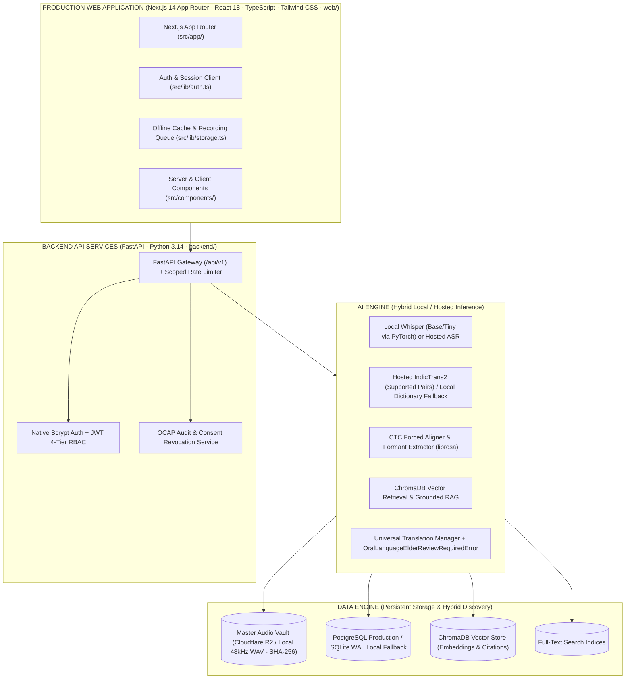

# Voice Roots v2.0 – Post-Launch Architecture & Roadmap

> **Platform Status**: `Post-Launch (Deferred Scope)`  
> **Active Target**: v1.0 Production Capstone Launch (Phases 0–5)  
> **Protected Release Baseline**: `v1.0.1-pilot-ready` (Tag preserved, commit `c87d497`)  
> **Frozen Non-Launch Scope**: Flutter mobile (`flutter_app/`) and Expo mobile (`mobile/`) remain strictly frozen. The v2.0 modules (language explorer, dialect maps, spaced repetition, pronunciation scoring, model-rollback dashboard, speaker diarization) are deferred to post-launch.  
> **Production Web Stack**: Next.js 14 App Router (`web/`) · TypeScript · Tailwind CSS · React Server & Client Components  
> **Production Backend Stack**: FastAPI (Python 3.14) · PostgreSQL / SQLite WAL · ChromaDB · Cloudflare R2 / Private Storage  
> **Cloud Spend Rule**: Offline/local mode stays supported ($0.00 required external spend); hosted production mode may use hosted inference endpoints (e.g., IndicTrans2, hosted ASR).  
> **Preservation Governance**: Strict adherence to OCAP® Principles (Ownership, Control, Access, Possession).  

---

## 1. Executive Vision & Architectural Tenets

Voice Roots is an institutional-grade computational linguistics and community preservation platform engineered specifically for vulnerable, endangered, and oral Dravidian and tribal languages that lack standard orthographies or commercial NLP support (Gondi, Koya, Santhali, Lambadi).

While the immediate production launch focuses on the core web application, master audio immutability, PostgreSQL migration, and consent lifecycle, the **v2.0 Post-Launch Roadmap** plans the long-term expansion into advanced acoustic phonetics, phylogenetic cartography, and community pedagogical studios.



### Immutable Core Invariants

1. **Master Audio Immutability**: Original 48kHz audio recordings are unalterable master assets stored with SHA-256 checksums. AI transcripts and translations are strictly annotation layers and can never overwrite master recordings.
2. **Mandatory Affirmative Consent**: Recording, processing, or indexing audio requires explicit consent. Consent can be revoked unilaterally by the speaker or tribal council at any time with cascading removal.
3. **Cloud Spend Policy**: Offline/local mode stays supported with $0.00 required external cloud API spend using local models; hosted mode may use designated hosted inference endpoints (such as IndicTrans2) with strict rate limits and zero data retention.
4. **Indigenous Oral Protection**: Automated machine translation of unwritten oral tongues without elder approval is structurally blocked with `OralLanguageElderReviewRequiredError`.
5. **Sacred Lore Shielding**: Sensitive cultural narratives (`SACRED_ELDER_ONLY`) are masked from public search and restricted to verified community elders (OCAP principles).

---

## 2. Seven Post-Launch Feature Groups (Modules 1–7)

*Note: In accordance with the Production Launch scope freeze, all seven feature groups below are designated post-launch extensions.*

### Module 1: Advanced Speech Intelligence (Priority 1)

- **Dialect Identification**: Acoustic classifier to distinguish regional dialect variations (e.g., Adilabad Gondi vs. Betul Gondi, Bhadrachalam Koya vs. Sukma Koya).
- **Word-Level Audio Alignment**: CTC forced alignment generating start/end millisecond timestamps for every transcribed word.
- **Phonetic Transcription (IPA)**: Rule-based and acoustic International Phonetic Alphabet (IPA) representation of unwritten oral utterances.
- **Speaker Diarization**: Multi-speaker clustering separating elder storytellers from interviewers.
- **Audio Pre-Processing**: Adaptive noise filtering, spectral gating, and normalization for field-recorded microphone captures.
- **Confidence Scoring & Uncertainty Highlighting**: Token-level acoustic confidence scores highlighting ambiguous words for community review.
- **Human-in-the-Loop Review**: Direct workflow for community elders to approve, reject, or correct phonetic transcriptions.

### Module 2: Multilingual Dictionary (Priority 2)

- **Four Primary Core Dialects**: Searchable lexical entries for Gondi (`gon`), Koya (`kfa`), Santhali (`sat`), and Lambadi (`lmn`).
- **Orthographic Inclusivity**: Stores standard script, native scripts (Gunjala Gondi, Masaram Gondi, Ol Chiki), and regional Devanagari/Telugu transcriptions.
- **Acoustic Pronunciation Guides**: Embedded high-fidelity audio snippets linked to verified native speaker recordings.
- **Cross-Dialectal Comparisons**: Juxtaposes phonetic and semantic shifts across regional dialects.
- **Source Provenance & Etymology**: Full audit trail attributing each definition to specific speakers, recordings, and elders.
- **Elder Approval Gates**: Distinguishes unverified community proposals from verified elder-approved dictionary entries.

### Module 3: Voice Roots AI Assistant & RAG (Priority 3)

- **Bimodal Interaction**: Voice-based and text-based natural language interaction.
- **Local Offline RAG**: ChromaDB semantic retrieval paired with full-text keyword indexing to ground answers in verified community archives.
- **Source-Attributed Answers**: Every generated response includes clickable citation pills referencing original recordings and transcripts.
- **Strict Epistemic Guardrail**: Explicitly demarcates verified community knowledge from AI-synthesized linguistic hypotheses.
- **Zero-Cloud Local Operation**: Offline/local mode stays fully functional on local models with $0.00 cloud API costs.

### Module 4: Cultural Archives & Sacred Lore Shielding (Priority 4)

- **Oral Narrative Preservation**: Curated digital collections of folklore, traditional songs, ecological knowledge, and oral histories.
- **Interactive Audio Waveform Visualizer**: Responsive 56-bar animated waveform with progressive color fills, click-to-seek, and speed controls.
- **Synchronized Bilingual Transcript Player**: Dual-language sentence alignment highlighting the active spoken sentence in real time.
- **Multi-Level Custodianship**: Granular permissions (Public, Community-Only, Elder-Restricted, Sacred Ceremonial).
- **Consent Revocation Hook**: Instant cascading removal of transcripts, embeddings, and media if a community withdraws consent.

### Module 5: Interactive Language Explorer (Priority 5)

- **Phylogenetic Family Trees**: Interactive phylogenetic visualizations of Dravidian, Austroasiatic, and Indo-Aryan minority tongues.
- **Geographic Dialect Distribution**: Interactive mapping of linguistic varieties, speaking populations, and dialect borders.
- **Morphological & Lexical Relationship Graph**: Cytoscape-powered visualization of cognates, loanwords, and etymological roots.
- **Objective Vitality Indicators**: Documentation status grounded in community census data, avoiding speculative external extinction claims.

### Module 6: Advanced Learning Studio (Priority 6)

- **Pronunciation Evaluation**: Acoustic comparison of student attempts against native elder master recordings with formant feedback.
- **Spaced Repetition System (SRS)**: Leitner/SuperMemo-based vocabulary flashcards optimized for oral recall.
- **Listening Comprehension Quizzes**: Audio-first quizzes testing dialect comprehension without requiring literacy in dominant scripts.
- **Sentence Construction Drills**: Interactive phrase building using community-approved idioms and grammatical structures.
- **Learner Progress Analytics**: Client-side and authenticated progress telemetry tracking vocabulary mastery.

### Module 7: Institutional Command Center (Priority 7)

- **Comprehensive Preservation Telemetry**: Real-time aggregation of total audio hours, phonetic coverage, and dialect diversity.
- **Elder Moderation Queue**: Dedicated portal for elders to review pending transcripts, dictionary entries, and community stories.
- **Model Evaluation & Rollback Dashboard**: Empirical tracking of Word Error Rate (WER) and Character Error Rate (CER) across model versions with 1-click rollback.
- **Disaster Recovery & Atomic Backups**: One-click atomic snapshots and automated backup retention policies.
- **Audit Logs & Security Monitoring**: Real-time inspection of API token usage, research rate limits, and authentication events.

---

## 3. Ten Development Stages & Execution Schedule (M24 to M33)

| Stage | Focus Area | Deliverables | Exit Condition |
| :---: | :--- | :--- | :--- |
| **M24** | **Repository Audit & Foundation** | Baseline audit, branch isolation, modular scaffolds, master roadmap. | Clean working tree, all regression tests pass. |
| **M25** | **Speech Intelligence & Acoustic Pipeline** | CTC forced alignment, word-level timestamps, acoustic confidence scoring, noise reduction filters. | Word timestamps generated on test audio, uncertainty indicators displayed in UI. |
| **M26** | **Multilingual Dictionary Architecture** | `dictionary` table schema, CRUD endpoints, Gondi/Koya/Santhali/Lambadi seed lexicon, search UI. | Searchable approved entries, provenance tracing, audio pronunciation playback. |
| **M27** | **Grounded AI Assistant & Archive RAG** | Offline vector retrieval pipeline, local RAG router, citation pill generator, epistemic guardrails. | Grounded answers strictly citing verified community archives, $0.00 spend mode supported. |
| **M28** | **Governed Cultural Archives Enhancements** | Waveform player refinement, sacred lore access controls, community submission workflows. | Multi-tier permissions verified, sacred stories masked from unverified users. |
| **M29** | **Interactive Language Explorer** | Cytoscape ontology extensions, dialect cartography, language family trees. | Graph traversal across 44+ languages, verified Dravidian dialect relationships. |
| **M30** | **Advanced Learning Studio Upgrades** | Spaced repetition engine, pronunciation formant matching, oral listening drills. | Functional learning workflow with client-side offline sync. |
| **M31** | **Institutional Command Center** | Elder review queue UI, WER tracking dashboard, disaster recovery backup console. | Complete administrative workflows with role-based clearance checks. |
| **M32** | **End-to-End System Integration** | Cross-module verification, security penetration scan, rate limiter audit, PWA offline sync. | Zero regression test failures, clean ruff and tsc passes across entire repo. |
| **M33** | **Institutional Pilot Launch Preparation** | Ethics IRB package sign-off, tribal council agreements, bilingual oral consent audio prompts. | All 5 Operational Pilot Gates (G-01 to G-05) satisfied. |

---

## 4. Real Repository Codebase Architecture

```plaintext
voice-roots/
├── web/                         # Production Next.js 14 App Router application
│   ├── src/
│   │   ├── app/                 # App Router pages and API routes
│   │   ├── components/          # Reusable React components & UI layout
│   │   ├── lib/                 # Auth, storage, geo, and utility libraries
│   │   └── types/               # TypeScript interfaces
│   ├── public/                  # Static assets & PWA manifest
│   ├── next.config.mjs          # Next.js configuration & API proxy rewrites
│   └── package.json             # Web dependencies & scripts
├── backend/                     # FastAPI core backend service
│   ├── main.py                  # API endpoints & gateway
│   ├── auth_service.py          # Authentication & RBAC
│   ├── transcription_service.py # Speech transcription (Whisper/ASR)
│   ├── translation_service.py   # Translation & elder review guardrails
│   ├── vector_store.py          # ChromaDB semantic search
│   └── storage_service.py       # Audio master storage & signed URL handlers
├── data/
│   ├── audio/                   # SHA-256 master audio storage
│   ├── india/                   # Census 2011 & geographic datasets
│   └── census/                  # District and language population figures
├── tests/                       # Automated pytest regression suites (Milestones 1–33)
├── docs/                        # Specifications, contracts & guides
│   ├── V2.0_ROADMAP.md          # Post-launch v2.0 roadmap
│   ├── API_CONTRACT.md          # REST API contracts
│   └── DEPLOYMENT.md            # Production deployment guide
├── flutter_app/                 # FROZEN non-launch mobile app
├── mobile/                      # FROZEN non-launch Expo mobile app
└── PROGRESS.md                  # Handoff Log & Milestone ledger
```

---

## 5. Quality & Release Gates for Version 2.0

Every pull request or milestone branch merging into development must satisfy:

1. **Zero Regression Failures**: All existing automated tests must pass without unauthorized modification of test assertions.
2. **Static Code Quality**: `python3 -m ruff check backend/` must return 0 warnings/errors.
3. **Frontend Type Safety & Production Build**: `npm run build --prefix web` (Next.js 14 App Router) must compile cleanly with exit code 0.
4. **Data Sovereignty Compliance**: Master audio files remain read-only; unconsented recordings are rejected at HTTP 400; unreviewed oral translations fail gracefully.
5. **Cloud Spend Policy**: Offline/local mode supported with $0.00 required spend; hosted mode may use designated hosted endpoints with rate limiting.
